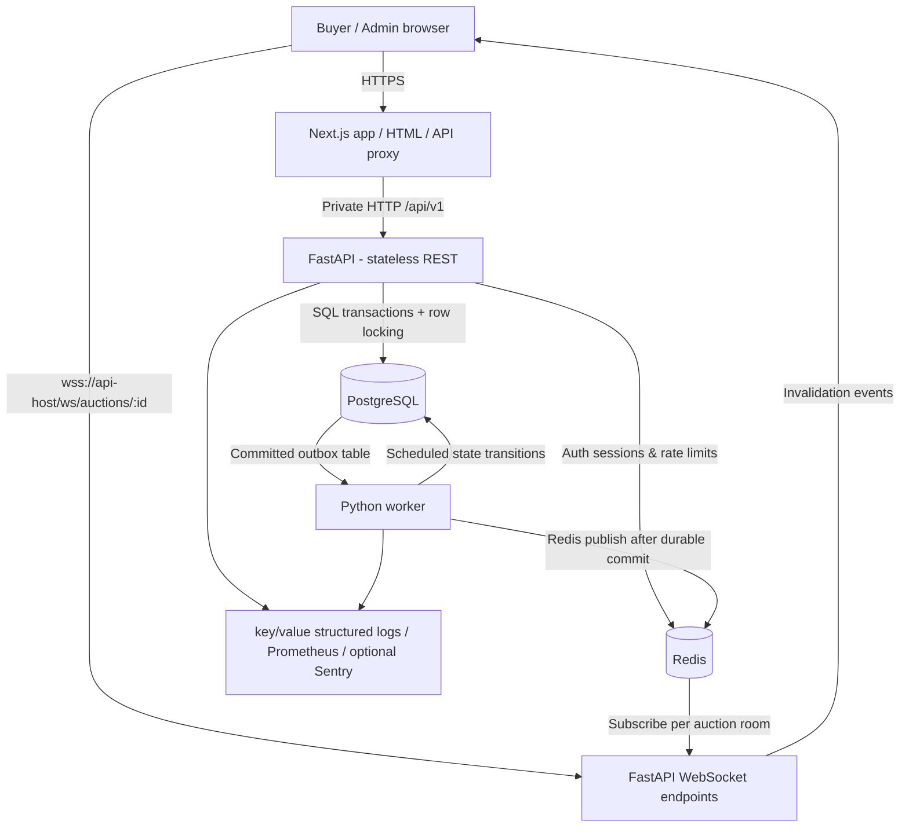
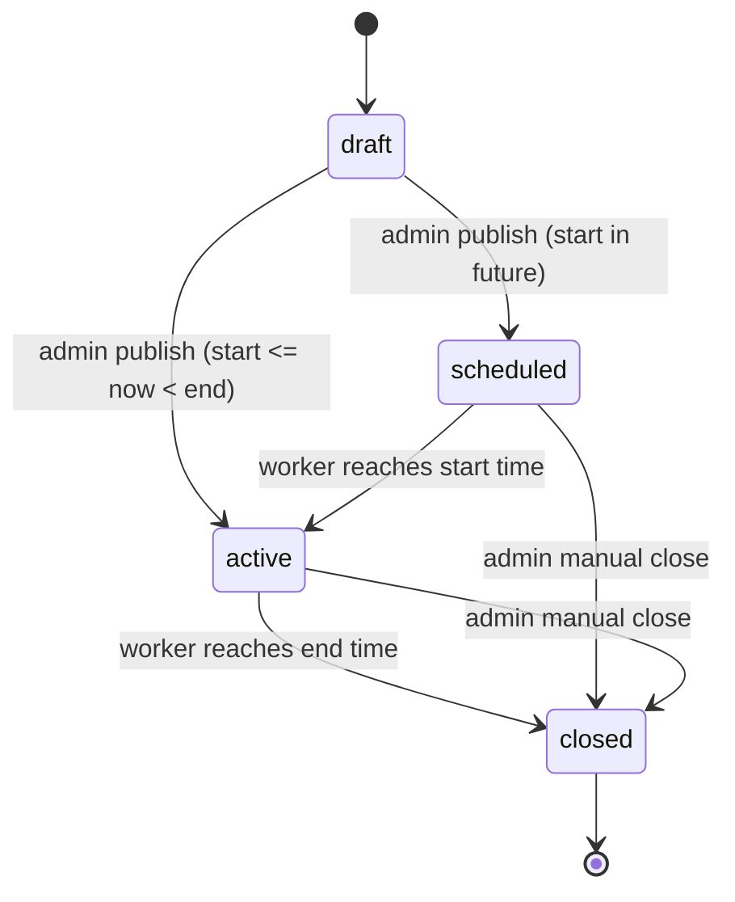

# Architecture and engineering decisions

## 1. Goals and non-goals

**Goal:** a functional, responsive demonstration of a used-motorcycle auction marketplace with accounts, several simultaneous auctions, accurate competing bids, staff lifecycle controls, near-real-time updates, and operational diagnostics.

**Non-goals for this internship scope:** payment escrow, delivery, KYC/title-transfer integration, fraud scoring, notification emails/SMS, automatic extensions (anti-sniping), bidding deposits, multi-currency support, and a legal marketplace launch. These would be mandatory product decisions before handling real money.

**Guarantees:** (1) committed bid history is append-only through application APIs; (2) for each auction, bid decisions are serialized by a PostgreSQL row lock; (3) expired auctions reject bids based on PostgreSQL server time; (4) identical (buyer, auction, idempotency key) retries return the prior bid; (5) closing selects the latest highest accepted bidder; (6) events persist through an outbox if Redis is unavailable. Network updates are *at-least-once* and clients periodically reconcile.

## 2. System diagram



The web application proxies normal API calls under its own origin, allowing `HttpOnly; SameSite=Lax` cookies. Browsers open read-only WebSockets directly to the public FastAPI WebSocket endpoint; server checks the exact allowed `Origin`. WebSockets **never** accept bids. FastAPI can scale independently of Next.js and the single example worker.

## 3. Data model

- `users`: UUID, email UNIQUE, display name, Argon2id password hash, `buyer|admin` role, created time.
- `auctions`: UUID, bike attributes, INR prices stored as **integer paise** in BIGINT, UTC timestamptz start/end, `draft|scheduled|active|closed`, nullable current price, high bidder UUID, winner UUID, increasing `version`, and `bid_count`.
- `bids`: UUID, auction UUID, buyer UUID, amount BIGINT, acceptance `auction_version` (unique per auction), idempotency key, database clock timestamp. `(auction_id, bidder_id, idempotency_key)` UNIQUE.
- `outbox_events`: UUID, auction UUID, auction version, action, created time, nullable published time. Indexed for polling unpublished events.

All data-changing API operations use schema validation. DB constraints defend against negative prices, impossible date ordering, and duplicate bid retries even if a route is incorrectly implemented. Single currency (INR) avoids FX complexities.

## 4. Bid transaction (linearization point)

```mermaid
sequenceDiagram
    participant Browser
    participant FastAPI
    participant PostgreSQL
    participant Worker
    participant Redis
    Browser->>FastAPI: POST /auctions/{id}/bids + idempotency key
    FastAPI->>PostgreSQL: BEGIN / SELECT auction FOR UPDATE
    PostgreSQL-->>FastAPI: exclusive auction row lock
    FastAPI->>PostgreSQL: Check existing idempotency key
    FastAPI->>PostgreSQL: SELECT clock_timestamp()
    Note over FastAPI: Validate active status, start <= now < end, minimum, leader != bidder
    FastAPI->>PostgreSQL: INSERT bid; UPDATE auction; INSERT outbox
    FastAPI->>PostgreSQL: COMMIT (bid is accepted)
    FastAPI-->>Browser: 201 Bid accepted (or 409 conflict)
    Worker->>PostgreSQL: Lock unpublished outbox records
    Worker->>Redis: PUBLISH invalidation (at least once)
    Redis-->>Browser: WS auction_changed (via subscribed API instance)
    Browser->>FastAPI: GET auction and recent bids (via proxy)
```

Two equal bids racing for one auction cannot both be accepted: the losing transaction sees the updated current price after waiting for the first row lock and gets `409 Conflict`. A retry using the same idempotency key returns the original bid, **even after the auction has closed**; a reused key for a different amount gets `409`. HTTP responses reflect the result of a committed DB transaction; no optimistic frontend state is treated as accepted.

**Minimum first bid:** starting price; subsequently, last accepted bid + minimum increment. A current high bidder cannot outbid themselves; this is a product assumption to prevent artificial bid escalation.

## 5. Auction lifecycle



The background worker polls once per second and uses `FOR UPDATE SKIP LOCKED`. A database timestamp is authoritative; the UI timer is only for display. If the worker is down, the bid endpoint still enforces the exact end timestamp, so expired bids do not slip through. On restart the worker catches up on missed transitions. Closing copies `highest_bidder_id` to `winner_id`, or leaves it null if nobody bid. Published auctions are immutable in this implementation; a change request requires a new draft, simplifying fairness and auditing.

## 6. Real-time behavior and failure handling

**The transactional outbox** stores event metadata in the same commit as the bid/state change, eliminating the "DB committed, event lost during process crash" gap. Worker `PUBLISH` may happen more than once if its DB transaction fails after publish, therefore clients treat events as *invalidation hints*, **not** authoritative prices. A `version` integer supports stale-event deduplication and reconciliation.

WebSocket workflow: subscribe to Redis channel **before** reading a DB version, accept socket, emit initial sync, stream invalidation notifications. Client fetches fresh auction + recent bids after connecting or on messages; separately polls every 10 seconds to repair missed Redis notifications and reconnects with exponential backoff. Heartbeats help detect stale connections. Redis Pub/Sub is not durable; outbox is durable, but only active connected listeners receive each Pub/Sub event. Periodic REST reconciliation handles disconnected clients.

**Out-of-order events:** version numbers identify ordering, but the client currently refreshes for each event rather than replaying event state. At higher fanout, implement process-local channel multiplexing (currently one Redis subscription per socket), client-side request coalescing, a shared subscription per auction per API instance, message coalescing, and a durable stream (Kafka/Redis Streams) if replay is required.

**Potential edge cases:** if an administrator closes while a bidder submits, both lock the same auction row; the order of transactions determines which wins. At the precise end boundary (`now == ends_at`) a bid is refused. If Redis becomes unavailable, auth and live updates fail closed while committed DB state remains durable; provide HA Redis and operational alerting for a real deployment.

## 7. API contract (`/api/v1`)

| Method | Route | Access | Notes |
|---|---|---|---|
| POST | `/auth/register` | Public | Argon2 password hash, cookie session |
| POST | `/auth/login` | Public | Revocable Redis session; uniform invalid-credentials error |
| POST | `/auth/logout` | Public | Revoke session and clear browser cookie |
| GET | `/auth/me` | Signed in | User details |
| GET | `/auctions?status=active&limit=30&offset=0` | Public | Cursor/pagination upgrade advisable at scale |
| GET | `/auctions/{uuid}` | Public | Drafts not visible |
| GET | `/auctions/{uuid}/bids` | Public | Last 20, anonymized bidder alias |
| POST | `/auctions/{uuid}/bids` | Buyer | Integer paise + random idempotency key; 201/401/409/422/429 |
| GET | `/admin/auctions` | Admin | Includes drafts |
| POST | `/admin/auctions` | Admin | Create draft |
| POST | `/admin/auctions/{uuid}/publish` | Admin | Atomic draft -> scheduled/active |
| POST | `/admin/auctions/{uuid}/close` | Admin | Atomic close and winner selection |
| WebSocket | `/ws/auctions/{uuid}` | Public read-only | Exact Origin validation, snapshots/invalidation |
| GET | `/healthz` | Public | Liveness only |
| GET | `/readyz` | Public | PostgreSQL + Redis connectivity |
| GET | `/metrics` | Secret header | Prometheus-format metrics |

OpenAPI interactive schema: `/docs` on the API server. Production docs are informational; **unsafe API operations must be invoked through the web-origin proxy or with an appropriately configured Origin header**.

## 8. Security controls

- Passwords hashed with Argon2id through `pwdlib`; no plaintext storage.
- HMAC-signed JWT cookie with `HttpOnly`, `SameSite=Lax`, and `Secure` in production. Random `jti` is stored with a TTL in Redis, checked on every request and deleted on logout; session theft still requires a fully compromised token.
- Restricted browser CORS origin and exact `Origin` validation for every write, including unauthenticated auth endpoints, to prevent CSRF with cookies. No state mutation over GET or WebSocket.
- Server-side authorization for admin actions. Client-side admin routing is only a UX convenience.
- Registration and login are rate-limited by a hash of email address; bids are rate-limited by buyer ID using Redis. Since a reverse proxy multiplexes users, also apply independent per-IP/ASN limits at a trusted edge gateway and CAPTCHA or bot defense before public launch.
- Validation bounds for prices, year, distance travelled, user input, title, and description. URL inputs are accepted as `https://` only; **image fetching is not implemented** (no SSRF fetch).
- Parameterized SQLAlchemy SQL instead of string-formatted SQL; DB credentials only in environment variables.
- Security response headers and private service network; production HTTPS and WSS required.
- Do not log authorization cookies, JWTs, plaintext passwords, or raw bid request bodies. `X-Request-ID` correlates HTTP requests.

**Further hardening before real-money use:** independent vulnerability audit, security event audit table, email verification, password reset and step-up MFA for admins, stricter response security headers/CSP, session/device management, bot defense, limit bid velocity per user/auction, identity checks and legal/financial review.

## 9. Observability and reliability

- HTTP request count and latency histograms from `prometheus_client`; `/metrics` requires `X-Metrics-Token`.
- API request logs with request ID, route template, status and milliseconds. Worker logs state transitions and outbox delivery failures. `SENTRY_DSN` enables optional error tracing.
- PostgreSQL and Redis connectivity readiness probe; `/healthz` independent of dependencies.
- Outbox backlog monitor query: `SELECT count(*), min(created_at) FROM outbox_events WHERE published_at IS NULL;`.
- Stuck auctions query: `SELECT count(*) FROM auctions WHERE status='active' AND ends_at < now() - interval '15 seconds';`.
- Alert suggestions: API 5xx > 1% for five minutes; p95 POST bids > 400ms; oldest unpublished outbox event > 30s; worker restart loops; DB connections/pool saturation; WebSocket reconnect spikes.
- Backup production PostgreSQL with PITR if provider supports it; enable Redis persistence for session continuity; restore-test regularly. Run migrations as a separate release action, not simultaneously in each API container.

## 10. Capacity plan and measured limits

**Starting design**: 1-2 API replicas, 1 worker, 1 web replica, managed PostgreSQL, managed Redis; small horizontal scaling based on real load. Connection pool currently 10 + max overflow 10 per Python service, so align maximum API replicas and worker connections with the PostgreSQL plan. Worker polls each second and processes batches of 100; if backlog rises, partition/shard work carefully and tune batch sizes.

No measured TPS or p99 latency claims are provided. Before public launch, load-test 50/200/1,000 concurrent watchers, test burst bids for a single hot auction and many simultaneous auctions, simulate DB failover and Redis disconnect, and define an achievable SLO from those results. The bid history is ordered by the acceptance version, not by a transaction-start timestamp. The hotspot is intentionally **one serial DB row per auction**; for extremely high bid volume use an auction-partitioned command processing model preserving a single ordered acceptance decision.

## 11. Explicit trade-offs

| Decision | Benefit | Cost / next step |
|---|---|---|
| Next.js API proxy | Same-origin cookies; no CORS gymnastics | Extra network hop and proxy service overhead |
| Python/FastAPI | Clear backend domain logic and native WebSockets | Two languages and two deployments |
| PostgreSQL row locks | Easy-to-audit bid correctness | Same-auction bids queue under contention |
| Polling worker | Easy recovery and predictable bounded lag | Not precisely on-time at millisecond scale |
| Transactional outbox + Redis Pub/Sub | Durable commit events, cheap fanout | Duplicates possible, not replayable |
| Redis-backed JWT sessions | Explicit logout revocation | Auth depends on Redis health |
| Public read-only WebSockets | Easy spectator UX, no credential over querystring | Configure strict Origin and connection limits |
| Basic bike SVG artwork | Beautiful responsive UI with no remote image dependency | Not representative of actual motorcycles |
| No payments / notifications | Concentrates on auction correctness and UI | Marketplace not ready for actual transactions |
| Single worker deployment | Predictable event order for assignment | Production scale may need ordered partitioning |
